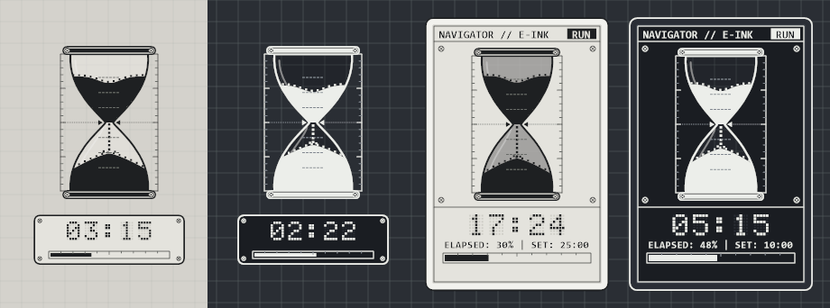

# ⏳ NAVIGATOR // E-Ink Hourglass Widget for Windows

> **초경량 투명 라인아트 & E-Ink(전자잉크) 도트 매트릭스 감성의 윈도우 데스크톱 모래시계 타이머 위젯**  
> 외부 라이브러리 설치 없이 **약 52KB 단일 실행 파일(`Hourglass.exe`)** 하나로 즉시 작동하며, 대기 시 **CPU 점유율 0.0%**를 유지합니다.



---

## 📥 다운로드 및 바로 실행하기 (Download)

별도의 설치 과정이 필요 없는 **무설치 포터블(Portable)** 버전입니다.

1. **[Releases 페이지](../../releases)** (또는 저장소 내 [`Hourglass_v1.0_Portable.zip`](Hourglass_v1.0_Portable.zip))를 다운로드합니다.
2. 압축을 풀고 **`Hourglass.exe`**를 더블클릭하면 화면 우측 하단에 모래시계가 나타납니다.

> 💡 **첫 실행 시 참고 사항 (Windows SmartScreen 안내)**  
> 본 프로그램은 개인 오픈소스 프로젝트로 유료 기업 코드 서명 인증서가 적용되어 있지 않아, 최초 실행 시 윈도우에서 **"Windows의 PC 보호 (알 수 없는 게시자)"** 파란색 안내창이 뜰 수 있습니다.  
> **`[추가 정보(More info)]` 클릭 ➔ `[실행(Run anyway)]`** 버튼을 누르면 정상 작동합니다. (최초 1회만 표시되며, 모든 소스 코드는 [`Program.cs`](Program.cs)에 100% 투명하게 공개되어 있습니다.)

---

## ✨ 주요 특징 (Key Features)

- **2가지 디스플레이 모드 실시간 전환 (단축키 `M` 또는 우클릭)**
  1. **투명 라인아트 계기판 모드**: 모래시계 외곽 배경이 100% 투명하여 어떤 작업 창 위에 올려두어도 시야를 가리지 않고 자연스럽게 어우러집니다.
  2. **E-Ink 디스플레이 패널 카드 모드**: 매트한 전자잉크 종이 질감 베젤 프레임 안에 상단 상태바(`RUN` / `HOLD` / `RDY` / `ALRM`), 모래시계 챔버, `5×7` 도트 시계, 선형 진행률 게이지가 통합된 위젯 모드입니다.
- **5가지 잉크 & 다크 반전(백라이트) 테마**
  - `라이트 잉크 (E-Paper 기본)` / `다크 반전 (화이트 라인)` / `웜 크림 계기판` / `다크 앰버 계기판` / `다크 그린 터미널`
- **압도적으로 가벼운 리소스 최적화**
  - 무거운 웹뷰(Electron/CEF) 없이 순수 Win32 Layered Window(`UpdateLayeredWindow`) API로 구현되었습니다.
  - 타이머 대기/일시정지 중에는 렌더링 타이머가 완전히 정지하여 **CPU를 0.0% 소모**합니다.
- **내장 2화음 차임벨 & 진동 알림**
  - 별도의 외부 오디오 파일 없이 메모리 내에서 직접 합성한 맑은 크리스탈 벨 화음과 시각 진동 효과로 종료를 알려줍니다.

---

## 🖱️ 조작 방법 (Controls)

| 동작 | 기능 설명 |
| :--- | :--- |
| **왼쪽 클릭 (1번)** | 타이머 **시작 / 일시정지** (알람이 울릴 때 클릭하면 **알람 해제 및 리셋**) |
| **더블 클릭 (2번)** | 모래시계 **180° 뒤집기 회전 애니메이션**과 함께 처음부터 재시작 |
| **마우스 드래그** | 화면 어디로든 원하는 위치로 자유롭게 이동 (위치 자동 저장) |
| **마우스 휠 스크롤** | 모래시계 위에서 바로 시간 조절 (**±1분** 단위, 1분 미만일 때는 **±10초** 단위) |
| **`Shift` + 마우스 휠** | **±5분** 단위 빠른 시간 조절 |
| **`Alt` + 마우스 휠** | **±10초** 단위 미세 시간 조절 |
| **`Ctrl` + 마우스 휠** | 모래시계 위젯 **크기 확대 / 축소 (60% ~ 220%)** |
| **가운데(휠) 클릭** | 하단 도트 디지털 타이머 표시 켜기 / 끄기 |
| **단축키 `M`** | **'투명 라인아트 모드' ↔ 'E-Ink 디스플레이 패널 모드'** 즉시 전환 |
| **마우스 우클릭** | 빠른 시간 프리셋(`30초`~`60분`), 시간 직접 입력, 테마 변경, 항상 위 고정 설정 메뉴 |

---

## 🛠️ 직접 빌드하기 (Build from Source)

윈도우 10 / 11에 기본 내장된 `.NET Framework C# 컴파일러(csc.exe)` 또는 `.NET SDK`로 즉시 빌드할 수 있습니다.

```powershell
# Windows 기본 내장 컴파일러로 단일 파일(52KB) 빌드
C:\Windows\Microsoft.NET\Framework64\v4.0.30319\csc.exe /target:winexe /optimize+ /win32icon:hourglass.ico /out:Hourglass.exe Program.cs

# 또는 .NET SDK 사용 시
dotnet build -c Release
```

---

## 📄 라이선스 (License)

이 프로젝트는 **[MIT License](LICENSE)**에 따라 배포되며, 누구나 자유롭게 사용·수정·재배포할 수 있습니다.
